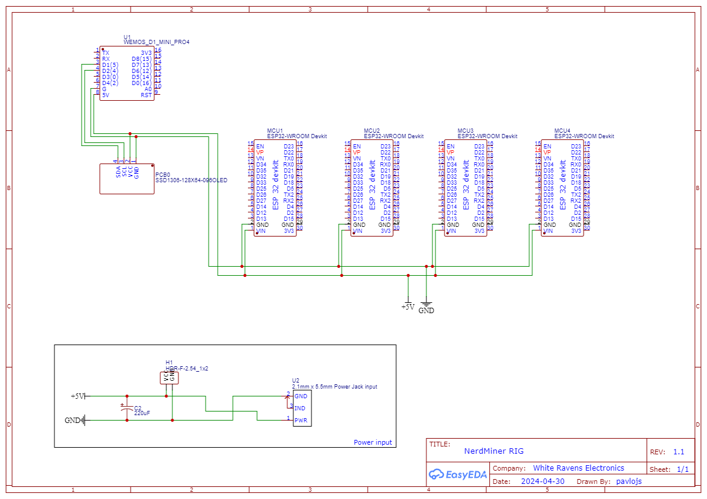
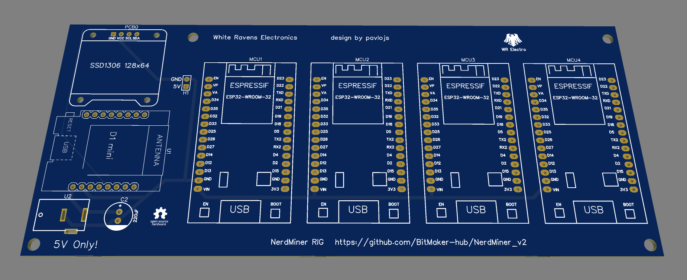

# NerdMiner RIG

**The NerdSoloMiner v2**

I designed a dedicated PCB to serve as a mining RIG for up to 4 ESP boards running the NerdMiner v2 software. No fancy display this time (but still eye-catching). An ESP8266 controls an OLED display that shows the current mining pool status, date & time, and your account statistics.

This project assumes some familiarity with VS Code and PlatformIO (or the Arduino IDE) and basic electronics, and is designed to help save space for your miners (more performance, less bulk).

The ESP8266 reads the statistics from the public API of the pool your miners use: [public-pool.io](https://web.public-pool.io/) (the NerdMiner default) or your own [public-pool](https://github.com/benjamin-wilson/public-pool) instance, and ckpool pools such as the official NerdMiner pool [pool.nerdminers.org](https://pool.nerdminers.org/) or [solo.ckpool.org](https://solo.ckpool.org/). You can omit the OLED display and ESP8266 entirely and use the “bare” PCB as a rig. On the other hand, you can stack multiple PCBs together, using the 5V and GND pins, to save even more space.

## Requirements

### Hardware

- PCB  
- Up to 4 × ESP32-WROOM-32 DevKit v1 (30-pin board)  
- ESP8266 D1 Mini  
- 0.96-inch OLED SSD1306 Display I2C 128×64  
- Electrolytic capacitor 220µF  
- Barrel jack connector 2.1 × 5.5 mm  
- 2-pin 2.54 mm female header, only to stack PCBs  
- 5V power adapter (minimum 2A recommended; more if multiple PCBs are used)  

You can also power your RIG with a micro-USB cable connected to the ESP8266 instead of using the barrel jack connector.

### Schematics



The OLED display connects to the D1 Mini with SDA on ```D1``` and SCL on ```D2```, at I2C address ```0x3C```.

### Software

- [Git](https://git-scm.com/) to get the code  
- [VS Code](https://code.visualstudio.com/) with the [PlatformIO IDE](https://platformio.org/install/ide?install=vscode) extension (recommended: it also updates the display over Wi-Fi, flashes the miners and runs the tests), or [Arduino IDE 2.0](https://www.arduino.cc/en/software)  
- Optional, for the miners: [NM2 online flasher](https://flasher.bitronics.store/) or the [microMiners Flashtool](https://github.com/BitMaker-hub/NerdMiner_v2?tab=readme-ov-file#microminers-flashtool-recommended)  

## Build



- Download the Gerber files ([files/Gerber_PCB_Nerd-Miner-RIG.zip](files/Gerber_PCB_Nerd-Miner-RIG.zip)) and use a PCB manufacturer of your choice.  
- A super-simple acrylic “case” is also available if you want a nice desktop stand: [files/Nerd-Miner-RIG-Case.dxf](files/Nerd-Miner-RIG-Case.dxf).  
- Solder all components in place, following the schematic and PCB markings.  
- Flash the NerdMiner firmware on each ESP32, see [Flashing the miners](#flashing-the-miners).  
- Configure and upload the display firmware to the D1 Mini, see [Display firmware](#display-firmware).  

## Display firmware

### Getting the code

```
git clone https://github.com/pavlojs/nerdminer-rig.git
```

To update later, run ```git pull``` in the repository folder and upload the firmware again. Your ```main/secrets.h``` is not tracked by Git, so it stays in place.

### Configuration

In the ```main``` folder, copy ```secrets.example``` to ```secrets.h```. Inside the secrets file, add your Wi-Fi credentials, enter your BTC wallet address, choose the pool and set up a time zone. The ESP8266 connects to 2.4 GHz Wi-Fi networks only.

The display shows the stats of the pool and wallet your miners actually mine on, so ```WALLET_ADDR```, ```POOL_API``` and ```POOL_URL``` have to match the BTC address and the pool set in the NerdMiner configuration:

| Pool | Pool in NerdMiner | ```POOL_API``` | ```POOL_URL``` |
|---|---|---|---|
| public-pool.io (NerdMiner default) | ```public-pool.io```, port ```21496``` | ```PoolApi::PublicPool``` | ```https://public-pool.io:40557``` |
| pool.nerdminers.org | ```pool.nerdminers.org```, port ```3333``` | ```PoolApi::Ckpool``` | ```https://pool.nerdminers.org``` |
| solo.ckpool.org | ```stratum.ckpool.org```, port ```3333``` | ```PoolApi::Ckpool``` | ```https://solo.ckpool.org``` |

For your own public-pool instance, set ```POOL_URL``` to the address of its API, by default ```http://<server>:3334```.

```TIMEZONE``` takes a POSIX time zone string, which includes the daylight saving rules, so the clock switches on the right day by itself. Find the string for your zone in [posix_tz_db](https://github.com/nayarsystems/posix_tz_db/blob/master/zones.csv).

```OTA_PASSWORD``` turns on updates over Wi-Fi, see [Updates over Wi-Fi](#updates-over-wi-fi). Leave it empty to keep them off.

*If your ```secrets.h``` comes from an older version of this repository, copy the new settings from ```secrets.example``` into it: ```POOL_API```, ```POOL_URL```, ```TIMEZONE``` and ```OTA_PASSWORD``` are new, ```UTC_OFFSET``` and ```DST_REGION``` are gone.*

### Uploading with VS Code and PlatformIO

Open the repository folder in VS Code with the PlatformIO IDE extension installed. On the first build PlatformIO downloads the ESP8266 platform and the library versions pinned in ```platformio.ini```.

Connect the D1 Mini by USB and use the PlatformIO toolbar, or run these commands in the PlatformIO terminal:

- Build: ```pio run```
- Upload: ```pio run -t upload```
- Serial monitor: ```pio device monitor```

### Updates over Wi-Fi

Once the display runs, you can update it over Wi-Fi instead of opening the case:

1. Set ```OTA_PASSWORD``` in ```main/secrets.h``` (letters, digits, ```.```, ```-``` and ```_```) and upload once over USB.
2. Run ```pio run -e d1_mini_ota -t upload```, or *d1_mini_ota → Upload* in the PlatformIO sidebar. The display shows a progress bar and restarts with the new firmware.

The upload looks for the board as ```nerdminer-rig.local```. If your computer does not resolve ```.local``` names, use the IP address the board prints on the serial monitor after connecting to Wi-Fi: ```pio run -e d1_mini_ota -t upload --upload-port 192.168.1.50```. During the upload the board connects back to your computer on a random port between 10000 and 60000, so a firewall on the computer has to let that connection in.

### Uploading with Arduino IDE

In Arduino IDE, install ESP8266 board support via Boards Manager and download the required libraries. Then select your ESP8266 board before uploading the code.

1. Open **Arduino IDE → File → Preferences** and add this URL to *Additional Boards Manager URLs*:
```https://arduino.esp8266.com/stable/package_esp8266com_index.json```

2. Go to **Tools → Board → Boards Manager**, search for *ESP8266* and click *Install*.  

3. Select your board under **Tools → Board → ESP8266 Boards (D1 Mini clone)** and set **Tools → CPU Frequency** to *160 MHz*, which speeds up the encrypted connections to the pool.  

4. Install the required libraries via **Sketch → Include Library → Manage Libraries**: *Adafruit SSD1306*, *Adafruit GFX Library* and *ArduinoJson* (version 7).  

5. Open ```main/main.ino```, connect the board by USB, select the correct Port, and upload the code.

### What the display shows

The display switches pages every 10 seconds:

1. Clock and date
2. Your hashrate
3. Pool stats: users, workers and hashrate on ckpool; miners and hashrate on public-pool
4. Your stats: workers, shares and best share on ckpool; workers and best share on public-pool (it does not report share counts)

The stats are refreshed every minute, and the LED on the D1 Mini blinks after each refresh.

### Troubleshooting

Open the serial monitor (115200 baud) to see what the board does.

- **The startup animation does not stop:** the board cannot join Wi-Fi. Check ```WIFI_SSID``` and ```WIFI_PASS```, and that the network is 2.4 GHz.
- **Your stats stay at 0:** ```WALLET_ADDR```, ```POOL_API``` or ```POOL_URL``` do not match what the miners use. ckpool shows no stats for an address before its first shares.
- **```Pool stats not updated (HTTP …)```** or **```User stats not updated (HTTP …)```** on the serial monitor: the pool API did not answer, or ```POOL_API``` does not match the pool in ```POOL_URL```. A negative number means no connection; the display keeps the last values.
- **The time is off by an hour:** check ```TIMEZONE```.

## Flashing the miners

PlatformIO can write NerdMiner 1.8.3 to the ESP32 boards, one board at a time. It uses the ```ESP32-devKitv1_factory.bin``` image from the [NerdMiner 1.8.3 release](https://github.com/BitMaker-hub/NerdMiner_v2/releases/tag/nerdminer-release-V1.8.3).

1. Connect one ESP32 by USB.
2. Run ```pio run -e miner -t flash_miner```, or *miner → Custom → Flash NerdMiner* in the PlatformIO sidebar. The first run downloads the image and checks its SHA-256; if it does not match, nothing is flashed.
3. If the upload cannot connect, hold the BOOT button on the ESP32 while it starts. With more than one board connected, choose the port: ```pio run -e miner -t flash_miner --upload-port /dev/ttyUSB0``` (```COM3``` on Windows).

Writing the image also clears the Wi-Fi settings stored on the board, so the miner starts its setup network ```NerdMinerAP``` (password ```MineYourCoins```). There you enter your Wi-Fi, your BTC address and the pool: use the same pool and address as the display, see [Configuration](#configuration).

## Tests

Parsing of the pool API responses and the number formatting have unit tests that run on your computer, without a board. They need a C++ compiler such as GCC or Clang:

```
pio test -e native
```

## Security

How to report a vulnerability, and what to know about Wi-Fi secrets, the pool connection and updates over Wi-Fi: [SECURITY.md](SECURITY.md).

## License

[MIT](LICENSE)
